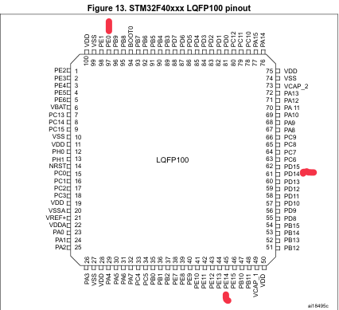
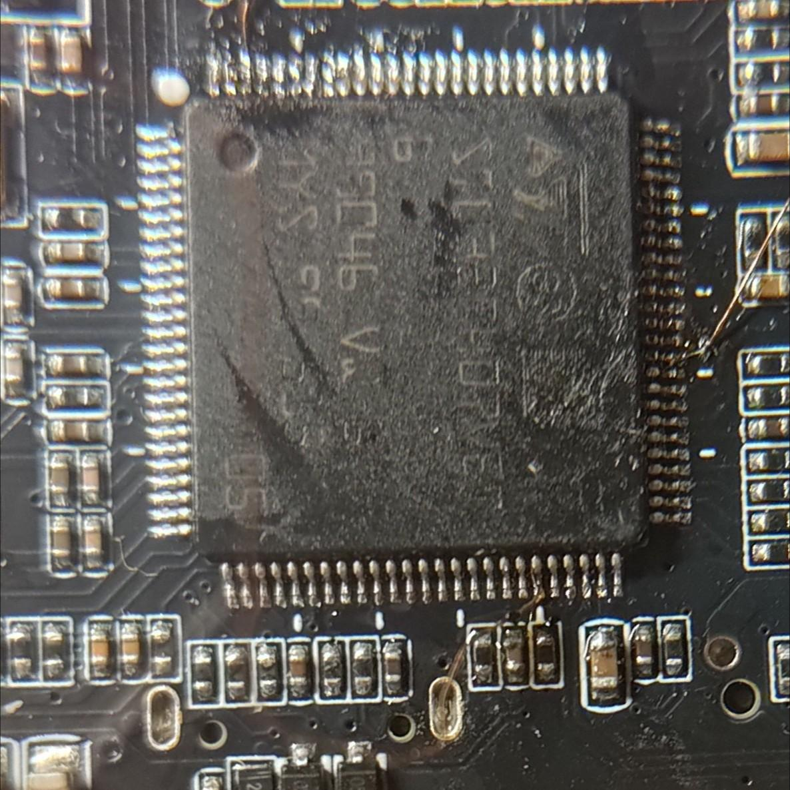
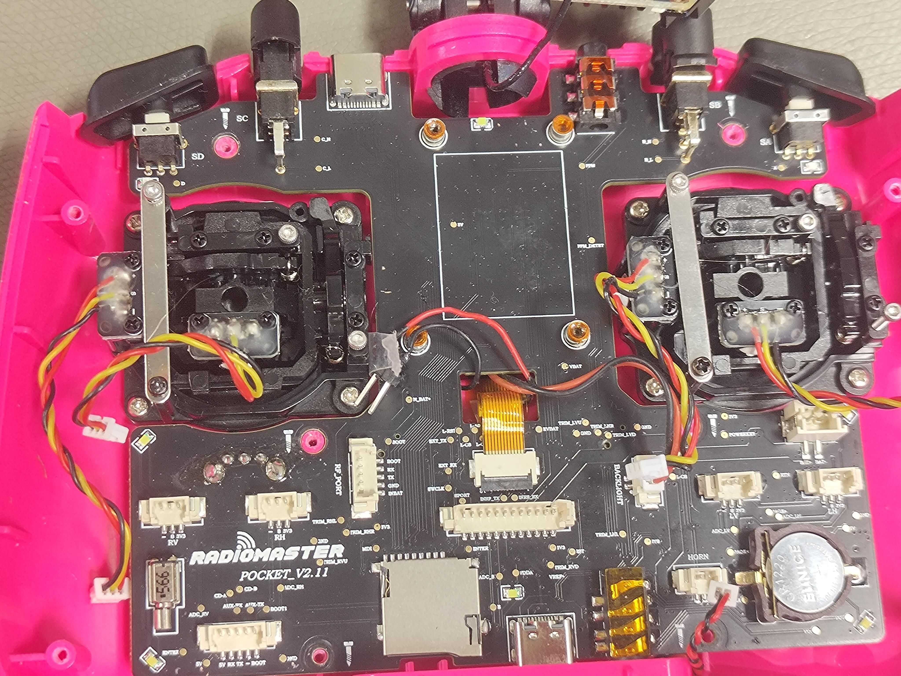
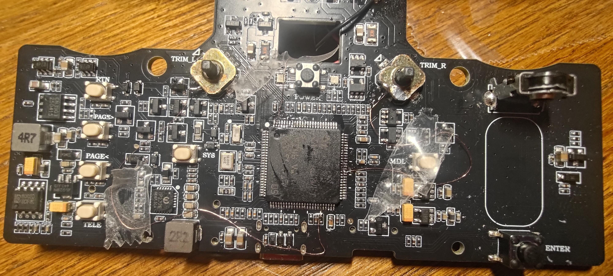
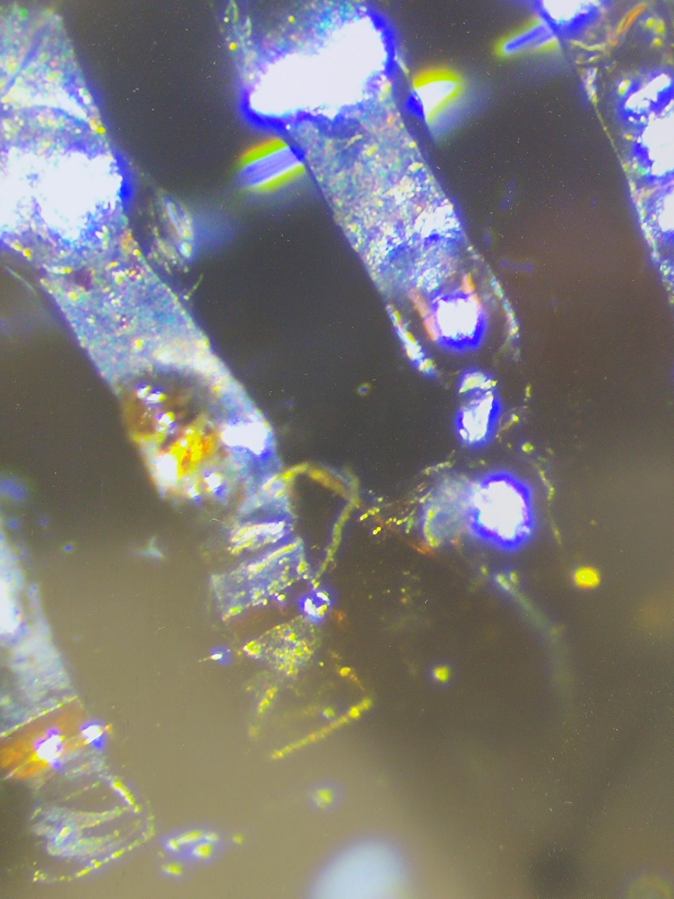
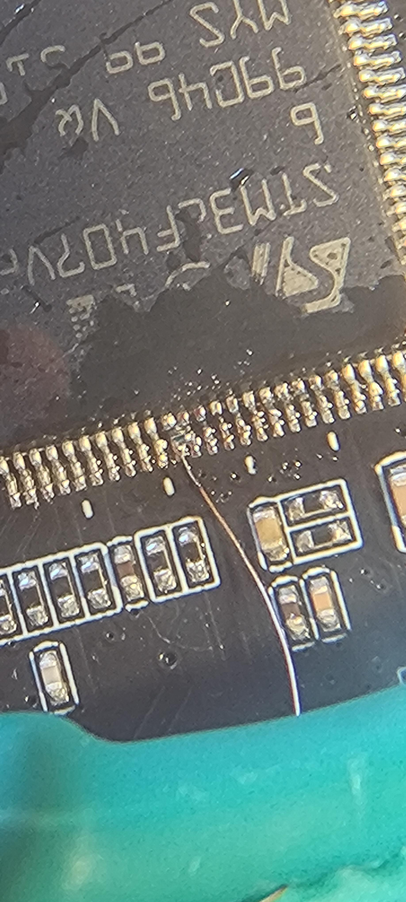
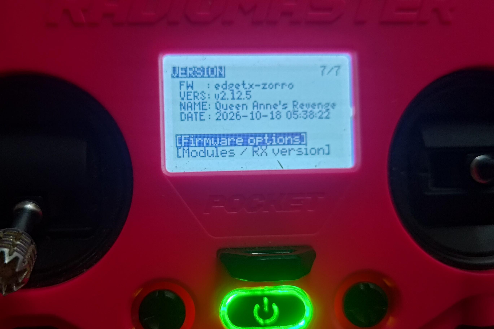

###### Disclaimer

This one is only for experts and the ones who don't care,
their rm pocket warranty is gone, I do not advise anyone to do that!
If you do it, you do it on your own risk.
There is also someone who did a video about doing this: [^1]

##### Skills/tools needed

Soldering:

- small soldering tip,
- copper wire

Linux

## How?

Because the chip of the rm Pocket is the same as in the rm Zorro,
and the Zorro has three more switches than the pocket,
you can add two 2 position switches and one 3 position switch
to your rm Pocket for free.

In the Following I will explain a bit about how to do that:

### Hardware

These are the chips which you should solder on with a copper wire:




[^2]

The bottom and right thin copper wire go to the middle of the trim switch button,
the upper one is a brand new three position switch you can wire together
with ground anywhere you want.
I did wire the switch to the back so I can connect it with a standard connector:

 
 

Be careful not to short anything on the stm32, not like i did [^3]:




### Software

Because EdgeTx blocks installing non native bins
(everything is blocked except RadioMaster pocket .bin),
you have to install the RadioMaster zorro .bin different ways.
Following way is flashing via stm32 bootloader with a Linux laptop.

#### steps

- Download a zorro build .bin(e.g from EdgeTx buddy)
- Install dfu-util on your Linux system
- Leave the rm pocket turned off and connect it via data cable with laptop
- The rm pocket should offer its stm32 bootloader

E.g it should look like this:

```bash
> dfu-util -l                                                                                                                                16:32:46
dfu-util 0.11

Copyright 2005-2009 Weston Schmidt, Harald Welte and OpenMoko Inc.
Copyright 2010-2021 Tormod Volden and Stefan Schmidt
This program is Free Software and has ABSOLUTELY NO WARRANTY
Please report bugs to http://sourceforge.net/p/dfu-util/tickets/

Found DFU: \[0483:df11\] ver=2200, devnum=72, cfg=1, intf=0, path="1-3", alt=3, name="@Device Feature/0xFFFF0000/01\*004 e", serial="367E396E3234"
Found DFU: \[0483:df11\] ver=2200, devnum=72, cfg=1, intf=0, path="1-3", alt=2, name="@OTP Memory /0x1FFF7800/01\*512 e,01\*016 e", serial="367E396E3234"
Found DFU: \[0483:df11\] ver=2200, devnum=72, cfg=1, intf=0, path="1-3", alt=1, name="@Option Bytes  /0x1FFFC000/01\*016 e", serial="367E396E3234"
Found DFU: \[0483:df11\] ver=2200, devnum=72, cfg=1, intf=0, path="1-3", alt=0, name="@Internal Flash  /0x08000000/04\*016Kg,01\*064Kg,07\*128Kg", serial="367E396E3234"
```

- @internal flash is the correct place to flash on
- you backup your system:

```bash
 sudo dfu-util -a 0 -d 0483:df11 -U pocket_backup.bin
```

- you flash e.g with following command:

```bash
sudo dfu-util -a 0 -d 0483:df11 --dfuse-address 0x08000000:leave -D v2.12.5-zorro.bin
```

- wait until the command has finished and the stm32 of the rm pocket has restarted
  now you can unplug the pocket and check if you have the new zorro firmware,
  now you can set your buttons to a channel and use them as you want :)

 

#### notes

[^1]: Video tutorial (not from me)[vid](https://www.youtube.com/watch?v=zxzVlCIHbjg)

[^2]: Datasheet side: [source](https://datasheet.octopart.com/STM32F407IET6-STMicroelectronics-datasheet-181247466.pdf)

[^3]:
    For me it was not that bad, that i shorted the stm32, the pocket just has not turned on, i checked the chip and found it.
    i think you cannot really damage the pcb so much if you are careful, so it is low risk, but still difficult.
