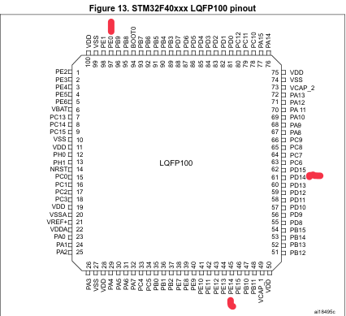

# The aim of this guide is to add more buttons to the Radiomaster Pocket

## How?

Because the chip of the rm Pocket is the same as in the rm Zorro,
and the Zorro has three more switches than the pocket,
you can add two 2 position switches and one 3 position switch
to your rm Pocket for free.

In the Following i explain a bit about how to do that:

### hardware

These are the chips which you should solder on with a copper wire

[Datasheet source](https://datasheet.octopart.com/STM32F407IET6-STMicroelectronics-datasheet-181247466.pdf)

The bottom and right thin copper wire go to the middle of the trim switch- button,
the upper one is a brand new three pos switch you can wire together
with ground anywhere you want.
Be carefull not to bridge anything on the board.

### Software

Because Edgetx blocks installing non native bins
(everything is blocked exept radiomaster pocket .bin),
you have to install the radiomaster zorro .bin different ways.
Following way is flashing via stm32 bootloader with a Linux laptop.

#### steps

- take download a zorro build .bin(e.g from Edgetx buddy)
- install dfu-util on your Linux system
- connect rm pocket via data cable with laptop
- rm pocket should offer its stm-32 bootloader

E.g it should look like this:

```bash
> dfu-util -l                                                                                                                                16:32:46
dfu-util 0.11

Copyright 2005-2009 Weston Schmidt, Harald Welte and OpenMoko Inc.
Copyright 2010-2021 Tormod Volden and Stefan Schmidt
This program is Free Software and has ABSOLUTELY NO WARRANTY
Please report bugs to http://sourceforge.net/p/dfu-util/tickets/

dfu-util: Cannot open DFU device 13d3:56ed found on devnum 25 (LIBUSB_ERROR_ACCESS)
Found DFU: \[0483:df11\] ver=2200, devnum=72, cfg=1, intf=0, path="1-3", alt=3, name="@Device Feature/0xFFFF0000/01\*004 e", serial="367E396E3234"
Found DFU: \[0483:df11\] ver=2200, devnum=72, cfg=1, intf=0, path="1-3", alt=2, name="@OTP Memory /0x1FFF7800/01\*512 e,01\*016 e", serial="367E396E3234"
Found DFU: \[0483:df11\] ver=2200, devnum=72, cfg=1, intf=0, path="1-3", alt=1, name="@Option Bytes  /0x1FFFC000/01\*016 e", serial="367E396E3234"
Found DFU: \[0483:df11\] ver=2200, devnum=72, cfg=1, intf=0, path="1-3", alt=0, name="@Internal Flash  /0x08000000/04\*016Kg,01\*064Kg,07\*128Kg", serial="367E396E3234"
```

- @internal flash is the is the correct place to flash on
- you flash e.g with following command:

```bash
sudo dfu-util -a 0 -d 0483:df11 --dfuse-address 0x08000000:leave -D v2.12.5-zorro.bin
```

- wait until the command has finished and your stm32 pocket has restarted
  now you can unplug the pocket and check if you have the new zorro firmware,
  now you can bind your buttons to channel and use them as you want :)
