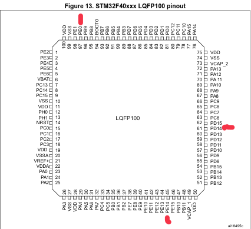

# The aim of this guide is to add more buttons to the radiomaster pocket

## How?

Because the chip of the rm pocket is the same as in the rm zorro
you can add 2 2 pos switches and one three pos switch

## how it works

### hardware

these are the chips which you should solder on with a copper wire

[datasheet](https://datasheet.octopart.com/STM32F407IET6-STMicroelectronics-datasheet-181247466.pdf)

### software

Because edgetx blocks installing non native bins(everything exept radiomaster pocket .bin)

#### steps to make

- take download a zorro build .bin
- connect pocket with laptop
- look if pocket offers as a stm32:

For example it should look like this:

```bash
> dfu-util -l                                                                                                                                16:32:46
dfu-util 0.11

Copyright 2005-2009 Weston Schmidt, Harald Welte and OpenMoko Inc.
Copyright 2010-2021 Tormod Volden and Stefan Schmidt
This program is Free Software and has ABSOLUTELY NO WARRANTY
Please report bugs to http://sourceforge.net/p/dfu-util/tickets/

dfu-util: Cannot open DFU device 13d3:56ed found on devnum 25 (LIBUSB_ERROR_ACCESS)
Found DFU: \[0483:df11\] ver=2200, devnum=72, cfg=1, intf=0, path="1-3", alt=3, name="@Device Feature/0xFFFF0000/01\*004 e", serial="367E396E3234"
Found DFU: \[0483:df11\] ver=2200, devnum=72, cfg=1, intf=0, path="1-3", alt=2, name="@OTP Memory /0x1FFF7800/01\*512 e,01\*016 e", serial="367E396E3234"
Found DFU: \[0483:df11\] ver=2200, devnum=72, cfg=1, intf=0, path="1-3", alt=1, name="@Option Bytes  /0x1FFFC000/01\*016 e", serial="367E396E3234"
Found DFU: \[0483:df11\] ver=2200, devnum=72, cfg=1, intf=0, path="1-3", alt=0, name="@Internal Flash  /0x08000000/04\*016Kg,01\*064Kg,07\*128Kg", serial="367E396E3234"
```

- @internal flash is the is the correct place to flash on
- then your flash command would look like this:

```bash
sudo dfu-util -a 0 -d 0483:df11 --dfuse-address 0x08000000:leave -D v2.12.5-zorro.bin
```

- bind your buttons to channel and look if everything has worked
