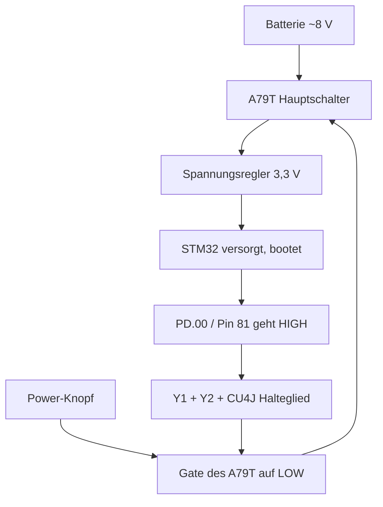

# RadioMaster Pocket – Debug-Session Zusammenfassung

**Stand:** 28.10.2026 · ✅ **GELÖST:** Die Ursache war eine kleine **Lötbrücke an der BOOT0-Leitung** (BOOT0 wurde auf ~2 V hochgezogen → Chip startete immer nur den ROM-Bootloader). Nach Entfernen bootet die Funke wieder normal – inklusive der neu eingebauten Tasten/Schalter. · Ursprüngliches Problem: Funke nach Schalter-Mod (Fourflies-Video „Upgrade your Radiomaster Pocket with more switches": SE/SF-Schalter an freie Mainboard-Pads gelötet) komplett tot: kein Display, kein Ton.

---

## 🎯 Aktueller Kernbefund: BOOT0 schwebt auf 2 V

Neueste Messungen am STM32 (LQFP100): **BOOT0 (Gehäuse-Pin 94) liegt bei eingeschaltetem Board bei ~2,0 V** – ausgeschaltet 0 V. Korrekt wäre: **fest 0 V in jedem Zustand**. Der Pull-down BOOT0→GND ist mit **3,1 kΩ messbar intakt**, die Widerstände am Pin sind optisch unauffällig. 2 V trotz funktionierendem Pull-down heißt: **Etwas anderes zieht BOOT0 aktiv hoch** (rechnerisch entspricht das einer Verbindung mit ~2 kΩ zur 3,3-V-Schiene) – fast sicher eine durch die Lötaktion des Schalter-Mods entstandene Verbindung (Lötbrücke, Zinnkügelchen oder die Mod-Verdrahtung liegt auf einem Pad der BOOT0-Leitung). Der Pegel liegt über der praktischen Umschaltschwelle (~1,6–1,8 V), der Chip wertet BOOT0 beim Start also als **HIGH** und bootet bei jedem Einschalten in den **ROM-Bootloader statt EdgeTX**.

**USB-Test (bestätigt):** Am PC erscheint **sofort „STM32 BOOTLOADER“** – ohne Power-Knopf, allein durch das USB-Kabel (das Board wird über USB versorgt); Knopfdruck ändert nichts. Der Chip sitzt also bei **jedem** Einschalten im Bootloader. Chip, Versorgung, Reset, Quarz und USB sind in Ordnung – nur kommt die Firmware nie dran.

Das erklärt **alle** Symptome vollständig:

- EdgeTX läuft nie → **PD.00 (Pin 81) wird nie auf 3,3 V gezogen** → der Soft-Power-Latch hält nicht → Power nur solange der Knopf gedrückt ist
- Display bleibt schwarz, kein Ton, keine Reaktion auf Trimm-Tasten
- Keine Erwärmung – es gibt keinen Kurzschluss, der Chip ist gesund und versorgt
- Chip ist nachweislich lebendig: VDD 3,3 V ✓, NRST 3,3 V (Reset freigegeben) ✓, VCAP 1,2 V (interner Kernregler aktiv) ✓

**→ Reparaturweg: die ungewollte Verbindung zwischen der BOOT0-Leitung und der Spannungsquelle finden und entfernen.** Kein Bauteiltausch, kein Board-Tausch – Chip und Firmware sind höchstwahrscheinlich intakt.

---

## 🔧 Identifizierte Bauteile der Soft-Power-Schaltung

| Aufdruck            | Bauteil                                                | Typ                                    | Pinout (Pin 1 = links, Aufdruck lesbar, Pins unten)              |
| ------------------- | ------------------------------------------------------ | -------------------------------------- | ---------------------------------------------------------------- |
| A79T (+ Loscode)    | **AO3407A** (bzw. Klone CDL3407A / TF3407 / IRLML9301) | P-Kanal-MOSFET, −30 V / −4,3 A, SOT-23 | 1 = Gate, 2 = Source, 3 = Drain                                  |
| Y1 (+ Loscode „CN") | **SS8050**                                             | NPN-Transistor, 25 V / 1,5 A, SOT-23   | 1 = Basis, 2 = Emitter, 3 = Kollektor                            |
| Y2 (+ Loscode „CA") | **SS8550**                                             | PNP-Transistor (Komplement zu SS8050)  | 1 = Basis, 2 = Emitter, 3 = Kollektor                            |
| CU4J                | **SN74LVC1GU04** (Texas Instruments)                   | Logik-Inverter, SOT-23-5               | 1 = n.c., 2 = Eingang A, 3 = GND, 4 = Ausgang Y, 5 = VCC (3,3 V) |

Hinweis: Vom AO3407A gibt es **viele Exemplare** auf dem Board – er ist der Standard-Allzweck-P-FET für Lastschaltungen (Haupt-Powerpfad, Batterie/USB-Umschaltung, RF-Modul-Versorgung, Beleuchtung). Die Latch-Transistoren (Y1/Y2) sitzen im Cluster neben dem Haupt-FET.

## ⚡ Funktionsprinzip der Soft-Power-Schaltung

Energiekette: Der FET liegt **vor** dem STM32 – er liefert die Spannung, mit der der Chip bootet. Signalkette: Nach dem Booten setzt die Firmware PD.00 (Pin 81) auf High; die Transistoren daneben halten das Gate des FET dauerhaft low → selbsthaltend. **Ohne laufende Firmware kein Haltesignal** – deshalb fällt alles beim Loslassen des Knopfs zusammen.

## 📌 STM32F407 – relevante Gehäuse-Pins (LQFP100)

| Funktion                      | Port          | Gehäuse-Pin             | Soll-Wert                                                                               |
| ----------------------------- | ------------- | ----------------------- | --------------------------------------------------------------------------------------- |
| PWR_ON (Latch-Ausgang)        | PD.00         | **81**                  | 3,3 V nach Firmware-Boot; aktuell 0 V → bestätigt: kein Firmware-Start                  |
| PWR_SWITCH (Knopf-Eingang)    | PD.01         | **82**                  | intern pull-up, Knopf zieht low; aktuell 0/0,175 V → Firmware aktiviert nie den Pull-up |
| NRST                          | –             | **14**                  | 3,3 V im Betrieb ✓ gemessen                                                             |
| BOOT0                         | –             | **94**                  | **fest 0 V**; gemessen 2 V → ✗ **Hauptfehler**                                          |
| VDD                           | –             | 11, 19, 28, 50, 75, 100 | 3,3 V ✓ gemessen (Pin 100)                                                              |
| VSS (GND)                     | –             | 10, 27, 74, 99          | Bezug                                                                                   |
| VCAP1 / VCAP2                 | –             | 49 / 73                 | ~1,2 V im Betrieb ✓ gemessen                                                            |
| PA9 (früherer Short-Verdacht) | PA9           | 68                      | GPIO-Short verhindert **keinen** Boot – als Ursache ausgeschlossen                      |
| Quarz (HSE)                   | PH0 / PH1     | 12 / 13                 | nur prüfen, falls BOOT0-Fix nicht hilft                                                 |
| Schalter SA                   | PC.13         | 7                       | –                                                                                       |
| Drehencoder                   | PE.09 / PE.10 | 41 / 42                 | –                                                                                       |

## 📋 Messprotokoll (chronologisch)

| #   | Messung                                                                                | Ergebnis                                                                 | Bewertung                                                                                                                                          |
| --- | -------------------------------------------------------------------------------------- | ------------------------------------------------------------------------ | -------------------------------------------------------------------------------------------------------------------------------------------------- |
| 1   | Batteriespannung am Board-Stecker                                                      | ~8 V, kein Kurzschluss                                                   | OK                                                                                                                                                 |
| 2   | 3,3-V-Rail bei Knopfdruck                                                              | kommt hoch, fällt beim Loslassen sofort ab                               | Latch hält nicht                                                                                                                                   |
| 3   | Reset-Prozedur RadioMaster (beide 18650 + CR1220 raus, 1–2 min, nur 18650 wieder rein) | keine Änderung                                                           | erwartbar – CR1220 (RTC-Backup) ist unschuldig, kann das Board nicht „töten"                                                                       |
| 4   | Pin 81 & 82 (Ruhe)                                                                     | 0 V                                                                      | Firmware läuft nie (kein Pull-up aktiv)                                                                                                            |
| 5   | Pin 81 & 82 (Knopf gedrückt)                                                           | 0,175 V statt 3,3 V                                                      | nur Durchgriff über Knopf-/Latch-Pfad; kein Baustein treibt aktiv                                                                                  |
| 6   | Erwärmung / Stromaufnahme                                                              | nirgends Hitze                                                           | kein Kurzschluss, Chip gesund                                                                                                                      |
| 7   | VDD am Chip (Knopf gedrückt)                                                           | 3,3 V                                                                    | ✓ Versorgung kommt am Chip an                                                                                                                      |
| 8   | NRST (Knopf gedrückt / Ruhe)                                                           | 3,3 V / 0 V                                                              | ✓ Reset wird korrekt freigegeben                                                                                                                   |
| 9   | VCAP (Knopf gedrückt)                                                                  | 1,2 V                                                                    | ✓ interner Kernregler aktiv – Chip startet hoch                                                                                                    |
| 10  | **BOOT0 (Knopf gedrückt / Ruhe)**                                                      | **2,0 V / 0 V**                                                          | ✗ **Hauptfehler: BOOT0 schwebt statt fest 0 V**                                                                                                    |
| 11  | „Haupt"-A79T: Source 3,7 V · Gate 7,7 V (reagiert nicht auf Knopf) · Drain 7,7 V       | passt nicht zum Soll (Source = volle Batterie, Gate → 0 V beim Druck)    | ⚠️ offen: vermutlich falscher FET erwischt oder anderes Bauteil; der Strompfad funktioniert nachweislich (VDD = 3,3 V)                             |
| 12  | BOOT0 → GND, Widerstandsmessung (stromlos)                                             | **3,1 kΩ**                                                               | ✓ Pull-down vorhanden und intakt – kein gerissener Pull-down                                                                                       |
| 13  | USB an PC, ohne Knopfdruck                                                             | sofort **„STM32 BOOTLOADER"** im Gerätemanager; Knopfdruck ändert nichts | ✗ **bestätigt**: Chip bootet bei JEDEM Start in den ROM-Bootloader; Board wird über USB allein versorgt; Ursache = BOOT0 wird auf ~2 V hochgezogen |

## ▶️ Nächste Schritte (in dieser Reihenfolge)

1. **Brücke eingrenzen (stromlos – Batterien und USB raus):** Widerstand von **BOOT0 (Pin 94) zur 3,3-V-Schiene** messen (z. B. VDD Pin 100 oder Pin 11). Erwartet: OL / Megaohm. Misst du ~2 kΩ oder weniger → ungewollte Verbindung bestätigt.
2. **Mod-Verdrahtung als Hauptverdächtiger:** Durchgang von BOOT0 zu **jedem Draht und Pad der neu eingebauten Schalter** messen (auch deren Common). Niedriger Widerstand = diese Verbindung liegt auf der BOOT0-Leitung → betreffende Lötstelle neu machen. Hinweis: Manche Boards führen BOOT0 zu Lötpads/„BOOT"-Punkten – die Mod-Pads könnten diese Leitung berühren.
3. **Chip-Nachbarn prüfen:** Unter der Lupe die Pins 93/94/95 (PB7 · BOOT0 · PB8) auf Lötbrücken/Zinngrate kontrollieren, ggf. mit Flux und Entlötlitze säubern.
4. **Brücke entfernen** bzw. die betreffende Lötstelle sauber neu ausführen.
5. **Erfolgskontrolle USB:** USB einstecken → jetzt darf **kein** „STM32 BOOTLOADER" mehr erscheinen (stattdessen normales EdgeTX-USB-Verhalten bzw. Display an). Danach Knopftest mit Batterien: Funke startet und **bleibt nach dem Loslassen an**.
6. **Falls danach noch schwarz:** EdgeTX neu flashen (Flasher auf edgetx.org oder STM32CubeProgrammer) – die Firmware ist wahrscheinlich intakt, nur für den Fall der Fälle.
7. **Notfall:** Ersatz-Mainboard ~40 € (n-Factory: RadioMaster Pocket Mainboard, 39,95 €).

## ❓ Offene Punkte (nicht blockierend)

- Der gemessene „Haupt-A79T" verhält sich nicht wie der Knopf-gesteuerte Schalter (Gate reagiert nicht). Entweder ein anderer A79T ist der eigentliche Hauptschalter, oder das Schalten passiert woanders (z. B. am Regler-Enable). Da die Versorgung nachweislich funktioniert (VDD = 3,3 V bei Druck): nach dem BOOT0-Fix neu bewerten.
- „Board leuchtet beim Messen": Beim Diodenmodus speist das Multimeter selbst Strom ein – LEDs können dadurch schwach angehen. Kein belastbarer Befund.

## 🔧 Nachtrag: SH-Taste mit Wackelkontakt-Symptom (offen)

**Symptome:** SH zappelt im Kanalmonitor, obwohl sie nicht gedrückt ist; drückt man sie, geht die Hintergrundbeleuchtung aus.

**Erklärung:** Beide Symptome passen auf **eine** Ursache – die SH-Leitung berührt ungewollt die **Beleuchtungs-Leitung (Backlight = PB.08, LQFP100-Pin 95, PWM über TIM10)**:

- Die Beleuchtung wird per **PWM** getaktet – dieser toggelnde Pegel aufs SH-Eingang lässt den Kanal im Monitor „zappeln", solange das Display beleuchtet ist.
- Drücken der Taste verbindet die Leitung mit GND → zieht die Beleuchtungs-Leitung mit runter → **Beleuchtung aus**.

Vermutlich wieder eine **Mikro-Lötbrücke an der SH-Lötstelle** (gleiches Fehlerbild wie bei BOOT0 – Pin 95 ist übrigens der direkte Nachbar von BOOT0/Pin 94) oder ein verquer verzinntes Pad.

**Überprüfen & beheben:**

1. Software-Bestätigung: Beleuchtung per Timeout ausgehen lassen → zappelt SH danach nicht mehr, ist die Kopplung ans Backlight bestätigt.
2. Stromlos machen (Batterien raus). Durchgang messen: SH-Draht ↔ STM32 PB8 (Gehäuse-Pin 95). Niedriger Widerstand = Brücke gefunden.
3. SH-Lötstellen unter der Lupe prüfen, Brücke mit Flux + Entlötlitze entfernen, neu löten.
4. Test: SH ruht im Kanalmonitor, Druck schaltet sauber, Beleuchtung bleibt an.

## 🔗 Quellen & Links

**EdgeTX / Firmware:**

- EdgeTX `hal.h` (PWR-Pins, Sektion „PWR and LED driver"): <https://github.com/EdgeTX/edgetx/blob/main/radio/src/targets/taranis/hal.h>
- OpenTX 2.3 `hal.h` (identische PWR-Definition): <https://github.com/opentx/opentx/blob/2.3/radio/src/targets/taranis/hal.h>
- Code-Suche in EdgeTX: <https://grep.app> (Filter: Repo `EdgeTX/edgetx`)

**Chip / Pinbelegung:**

- STM32F407 LQFP100 vollständige Pinbelegung: <https://gaw.ru/mcu/stm32/stm32f407vetx/>
- STM32F405/407 Pin-/Timer-/DMA-Übersicht (Betaflight): <https://betaflight.com/assets/files/stm32f405_pins_timers_dma-e7ae8fce49c50af781149b0458e4ac87.pdf>
  <https://datasheet.octopart.com/STM32F407IET6-STMicroelectronics-datasheet-181247466.pdf>

  **Bauteile-Datenblätter (SMD-Markierungen):**

- AO3407A (Markierung A79T): <https://cdn.promelec.ru/upload/items/2023/12/08/AO3407%20SOT-23.pdf>
- CDL3407A (Markierung A79T): <https://www.suntan.com.hk/pdf/Rectifier-Diode/CDL3407A-ME.pdf> · <https://www.kingtronics.com/pdf/KT-CDL3407A-ME.pdf>
- SN74LVC1GU04 (Markierung CU4J): <https://www.ti.com/lit/ds/symlink/sn74lvc1gu04.pdf> · <https://www.ti.com/product/SN74LVC1GU04>
- SMD-Markierungs-Suche (auch für Y1 = SS8050, Y2 = SS8550): <https://www.alldatasheet.net/view_marking.jsp?Searchword=A79T&sField=2> · alltransistors.com · smdmark.com

**Hardware-Referenzen:**

- Board-Fotos RadioMaster Pocket: <https://github.com/DongkwanYi/RM-POCKET-1W-MOD> (Ordner PhotoForReference; belegt u. a. 5-V-Versorgung des internen RF-Moduls)
- Video des Schalter-Mods: Fourflies, „Upgrade your Radiomaster Pocket with more switches" (YouTube)

**Ersatzteil:**

- RadioMaster Pocket Mainboard, 39,95 €: <https://www.n-factory.de>

